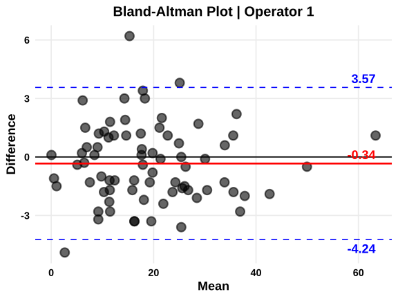
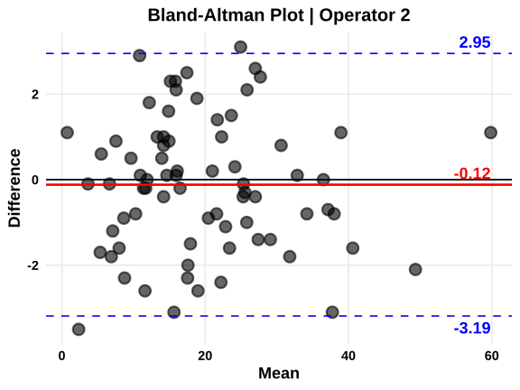
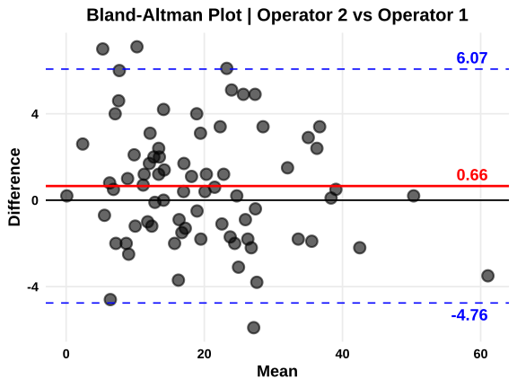
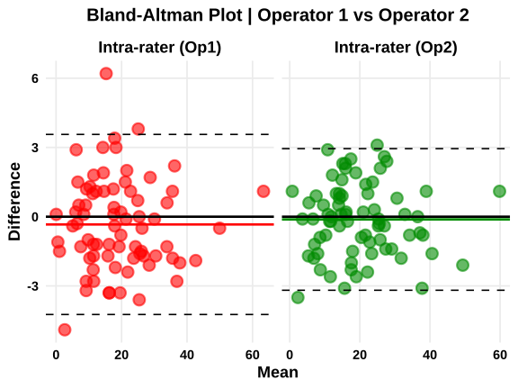
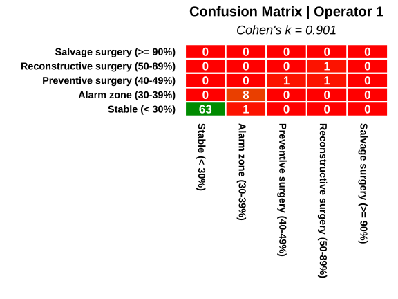
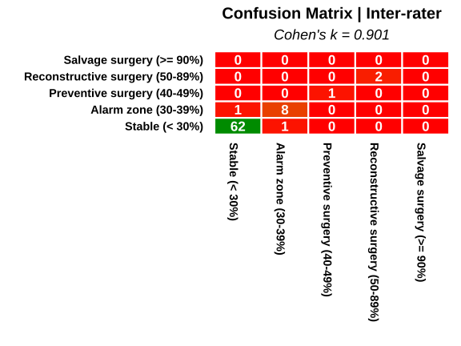

```{r}
#| label: setup
#| include: false

library(dplyr)
library(lubridate)
library(tidyr)
```

```{r}
#| label: icc
#| echo: false
#| results: asis

cat("\\begin{verbatim}\n")
cat("1) AGREEMENT ANALYSIS for continuous variable + Bland-Altman plots\n\n")

recap_var_cont <- readRDS("export/recap_var_cont.rds")
colnames(recap_var_cont) <- c("Parameter", "Operator 1", "Operator 2", "Inter-rater")
sep = c(rep("-", length(recap_var_cont)))
df_formatted <- recap_var_cont |>
    mutate(across(where(is.numeric), ~ sprintf("%.3f", .)))
df_with_header <- rbind(as.list(colnames(df_formatted)), sep,  df_formatted)
df_char <- as.data.frame(lapply(df_with_header, as.character), stringsAsFactors = FALSE)
df_aligned <- as.data.frame(mapply(format, df_char, justify = c("left", rep("right", ncol(df_char) - 1)), SIMPLIFY = FALSE), stringsAsFactors = FALSE)
write.table(
  df_aligned, 
  row.names = FALSE, 
  col.names = FALSE, 
  quote = FALSE, 
  sep = "     "
)

cat("\\end{verbatim}\n")
```

```{r}
#| label: bland-altman
#| echo: false
#| results: asis

cat("\\begin{verbatim}\n")

recap_ba <- readRDS("export/recap_ba.rds")
colnames(recap_ba) <- c("Analysys", "Diff (mean)", "Diff (SD)", "Lower limit", "Upper limit")
sep = c(rep("-", length(recap_ba)))
df_formatted <- recap_ba |>
  mutate(across(where(is.numeric), ~ sprintf("%.3f", .)))
df_with_header <- rbind(as.list(colnames(df_formatted)), sep, df_formatted)
df_char <- as.data.frame(lapply(df_with_header, as.character), stringsAsFactors = FALSE)
df_aligned <- as.data.frame(mapply(format, df_char, justify = c("left", rep("right", ncol(df_char) - 1)), SIMPLIFY = FALSE), stringsAsFactors = FALSE)
write.table(
  df_aligned, 
  row.names = FALSE, 
  col.names = FALSE, 
  quote = FALSE, 
  sep = "     "
)

cat("\\end{verbatim}\n")
cat("\\vspace{0.5cm}\n")
```

```{r}
#| label: plot_ba
#| echo: false
#| layout-ncol: 2
#| out-width: 100%





```

\newpage

```{r}
#| label: kappa
#| echo: false
#| results: asis

cat("\\begin{verbatim}\n")
cat("2) AGREEMENT ANALYSIS for categorical variable + Heatmap plots\n\n")

recap_var_cat <- readRDS("export/recap_var_cat.rds")
colnames(recap_var_cat) <- c("Parameter", "Operator 1", "Operator 2", "Inter-rater")
sep = c(rep("-", length(recap_var_cat)))
df_formatted <- recap_var_cat |>
  mutate(across(where(is.numeric), ~ sprintf("%.3f", .)))
df_with_header <- rbind(as.list(colnames(df_formatted)), sep, df_formatted)
df_char <- as.data.frame(lapply(df_with_header, as.character), stringsAsFactors = FALSE)
df_aligned <- as.data.frame(mapply(format, df_char, justify = c("left", rep("right", ncol(df_char) - 1)), SIMPLIFY = FALSE), stringsAsFactors = FALSE)
write.table(
  df_aligned, 
  row.names = FALSE, 
  col.names = FALSE, 
  quote = FALSE, 
  sep = "     "
)

cat("\\end{verbatim}\n")
```

```{r}
#| label: plot-heat
#| echo: false
#| layout-ncol: 2
#| out-width: 100%




```
